# 📦 FULLY AUTOMATED INVENTORY AND BILLING ERP SYSTEM PROJECT PRESENTATION
## Project Presentation | Microsoft Excel VBA
Presented by: Pradeep Kumar Kurrey 
Professional Focus: Advanced Excel & MIS Executive 
Technology: Microsoft Excel, VBA Macros, Data Validation

---
# 🖼️ Project Presentation — Slide Previews

This 11-slide presentation showcases my Excel VBA-based Inventory & Billing ERP System. It explains the system architecture, inventory control, automated billing, VBA workflow, validation controls, transaction audit trail, and key learning outcomes.

The presentation is intended to provide a structured overview of the system's design, demonstrated features, and business workflow.

---
## 🎬 Slide 1 — Project Introduction

Introduces the Fully Automated Inventory & Billing ERP System developed using Microsoft Excel VBA, highlighting its business process automation focus.

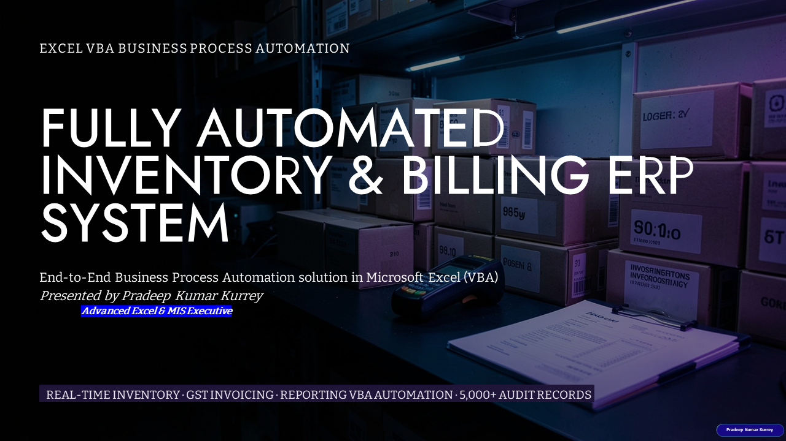

---

## 🏗️ Slide 2 — System Foundation

Explains the system architecture, centralized master sheets, VBA automation, data validation, and transaction audit logging.

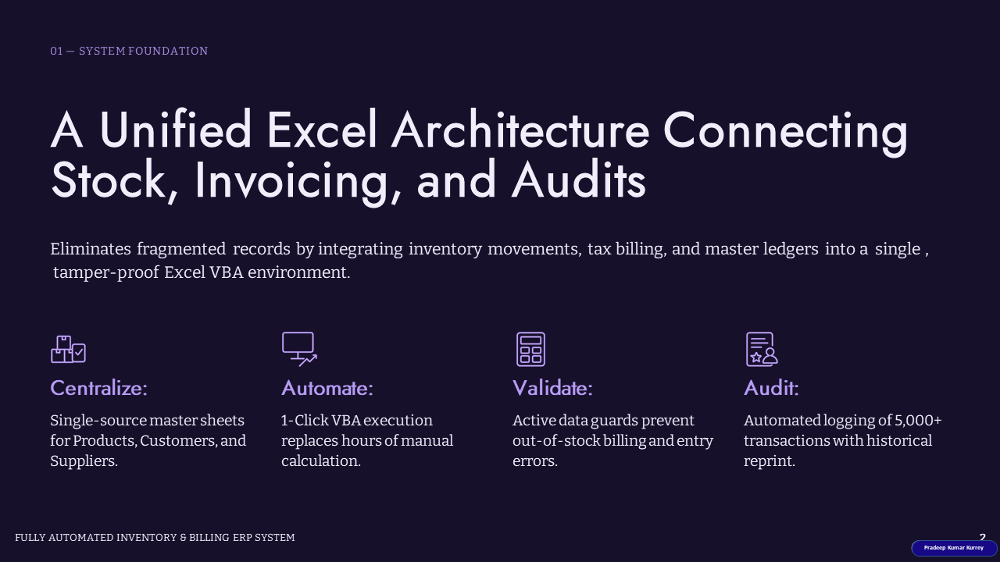

---

## ⚙️ Slide 3 — Operating Challenges and Objectives

Highlights common manual spreadsheet challenges and the objectives of automating inventory, billing, validation, and sales records.

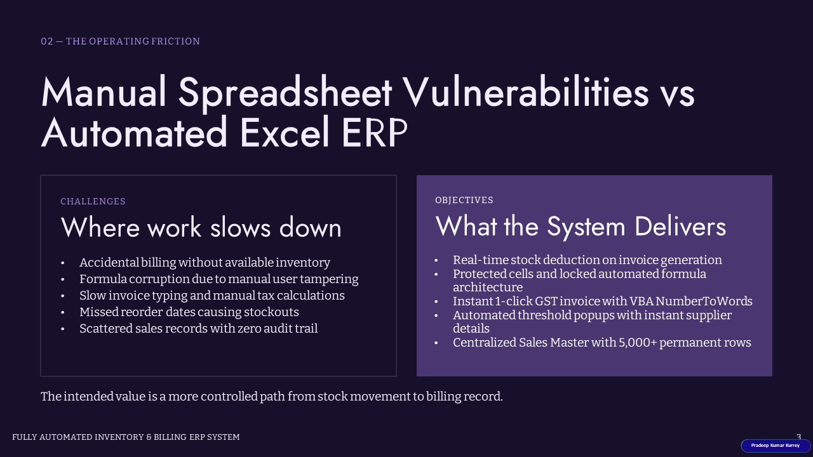

---

## 🔄 Slide 4 — Information Flow

Illustrates the flow of information across the connected modules, from master data and stock validation to billing and sales records.

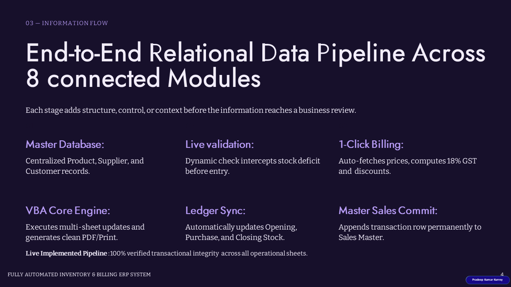

---

## 📦 Slide 5 — Inventory Control

Demonstrates stock tracking, available inventory, and reorder-level triggers for products that reach their configured stock thresholds.

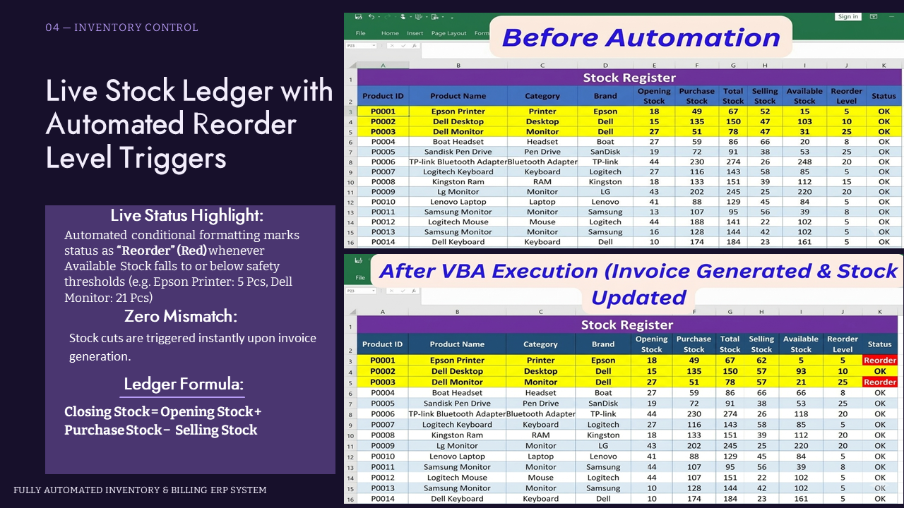

---

## 🧾 Slide 6 — Billing Automation

Showcases invoice generation, customer and product details, discount and GST calculations, amount-to-words conversion, and Save/Print actions.

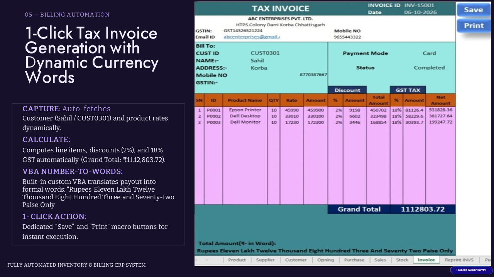

---

## 🔧 Slide 7 — VBA Control Path

Explains how VBA macros handle user actions, stock validation, invoice generation, multi-sheet updates, and form reset operations.

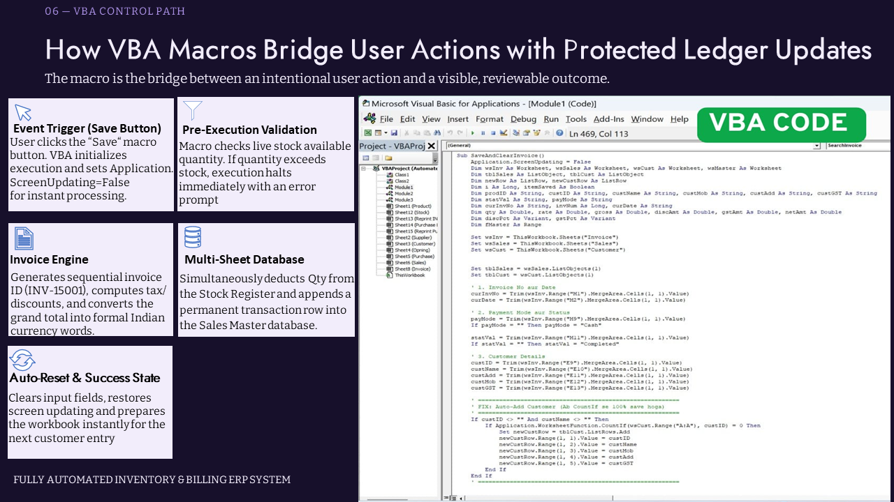

---

## 📊 Slide 8 — Operational Review

Presents operational indicators, including transaction records, tracked products, stock accuracy, and reorder alerts with supplier information.

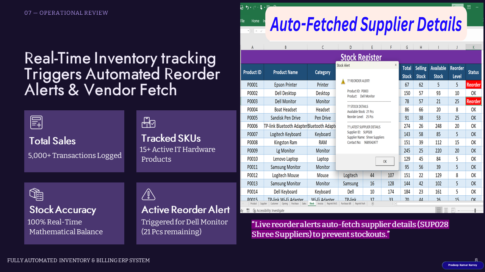

---

## 🛡️ Slide 9 — Validation Controls

Describes safeguards for over-ordering, invalid input, customer and product IDs, and protection of important calculation cells.

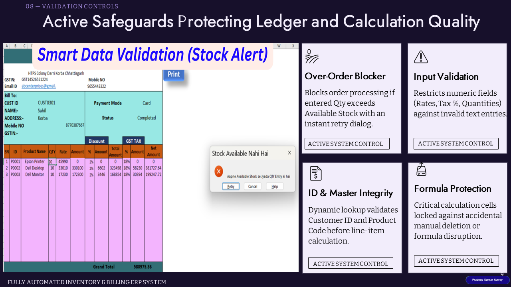

---

## 🔍 Slide 10 — Live Demonstration and Audit Trail

Summarizes the demonstrated invoice workflow, transaction entry, updated totals, historical records, and invoice duplication checks.

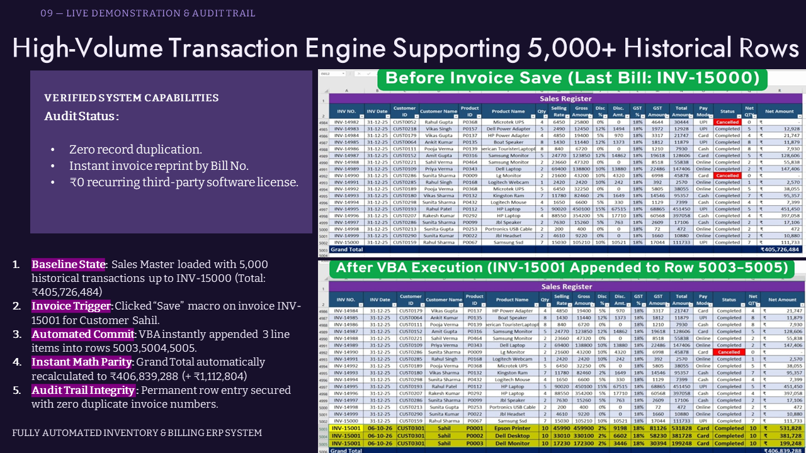

---

## 🎯 Slide 11 — Project Summary and Key Learnings

Concludes the presentation with the project overview, key functionalities, technology stack, and learning outcomes.

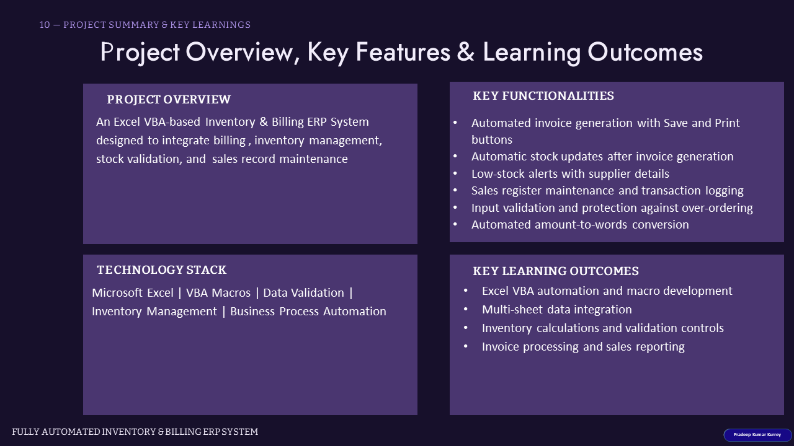

---

# 📥 Project Files — View & Download

## 1. PowerPoint Presentation

File: "FULLY-AUTOMATED-INVENTORY-and-BILLING-ERP-SYSTEM.pptx"

The 11-slide presentation explains the system architecture, inventory control, billing automation, VBA workflow, validation controls, operational review, and project summary.

## 2. Excel VBA ERP System

File: "FULLY-AUTOMATED-INVENTORY-and-BILLING-ERP-SYSTEM.xlsm"

The Excel Macro-Enabled Workbook contains the project implementation. It is intended to demonstrate inventory management and billing automation through Excel VBA.

«Note: Enable macros only when you trust the workbook and have reviewed its contents.»

## 3. PDF Presentation

File: "FULLY-AUTOMATED-INVENTORY-and-BILLING-ERP-SYSTEM.pdf"

A convenient, read-only format for reviewing the complete 11-slide project presentation without opening PowerPoint.

## 4. 💻 VBA Source Code — Automation Logic

File: "VBA Code.bas"

Contains the exported VBA module for reviewing the macro logic used in the Excel-based Inventory & Billing ERP System.

---
# 🚀 Key Features

- 🧾 Automated Sales Invoice Generation
- 🛒 Multi-Product Billing
- 📦 Automated Stock Management
- ⚠️ Low Stock / Reorder Alert
- 🚫 Stock Validation to prevent over-selling
- 🛍️ Automated Purchase Management
- 🔄 Sales Return Automation
- 🔄 Purchase Return Automation
- ❌ Cancelled Transaction Handling
- 🔎 Invoice Search & Retrieval
- 🧾 Purchase Bill Search & Retrieval
- 🖨️ Invoice & Purchase Bill Printing
- 👥 Customer & Supplier Management
- 🔢 Automatic Invoice Number Generation
- 💰 Automatic GST & Grand Total Calculation
- 📝 Amount in Words

---

# 🛠️ Tools & Technologies

- Microsoft Excel
- Excel Formulas
- VBA Automation
- Data Validation
- Conditional Formatting
- Excel Tables
- Inventory Management
- Billing Automation
- Stock Managemen

  ---

 # 🎯 Learning Outcomes

- Excel VBA automation and macro development
- Multi-sheet data integration
- Inventory calculations and validation controls
- Invoice processing and sales reporting
- Business workflow automation

---

# 👨‍💻 Author

Pradeep Kumar Kurrey
Advanced Excel & MIS Executive

- "GitHub Profile" (https://github.com/pradeepkurrey)
- "Portfolio Website" (https://pradeepkurrey.github.io/My-Website/)
- "LinkedIn Profile" (https://www.linkedin.com/in/pradeep-kurrey-data-analyst)
